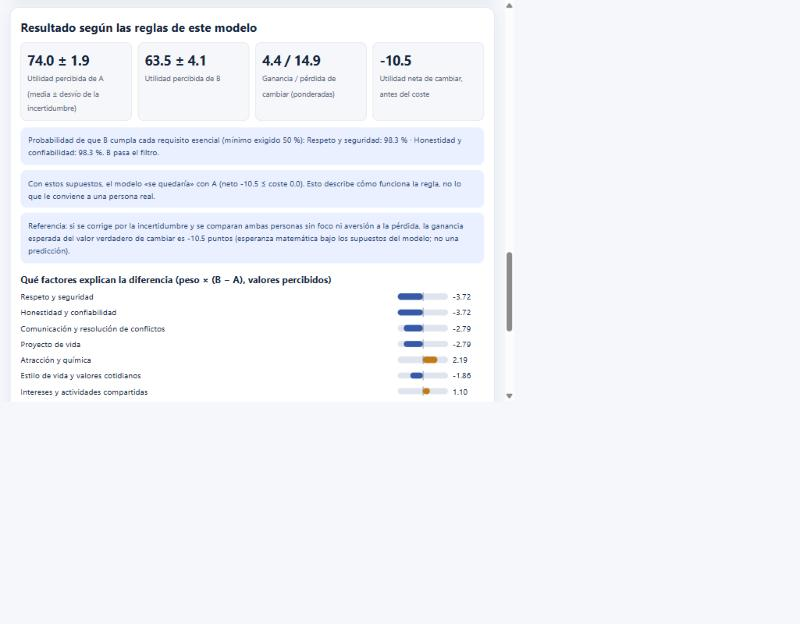
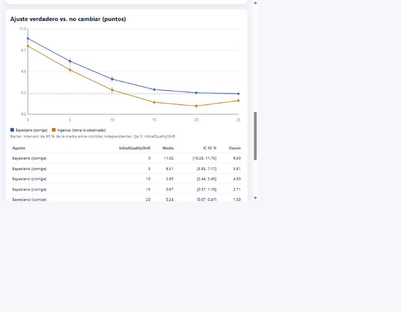

# Modelo standleymoise

**Modelo y simulador abierto sobre decisiones de elección de pareja bajo información incompleta** (repositorio `relationship-choice-model`).

> **Sobre el nombre.** «Modelo standleymoise» es el nombre y la atribución de este modelo en particular (sus ecuaciones, supuestos y código). Poner un nombre **no** afirma que sea una teoría nueva ni validada: la novedad se evalúa con honestidad en [`docs/antecedentes.md`](docs/antecedentes.md) y en la [revisión sistemática](docs/revision-sistematica/resultados.md).
[](https://doi.org/10.5281/zenodo.23310487) [](https://github.com/standleymoise/relationship-choice-model/actions/workflows/ci.yml)
*Exploratorio · versión 0.3.0 · no validado con datos de personas.*

Un proyecto técnico para explorar, con ecuaciones explícitas, agentes ficticios y código verificable, cuándo comparar una relación conocida con una alternativa poco conocida puede llevar a cambios que luego se lamentan, y cuándo no. Todo corre en JavaScript, HTML y CSS, sin dependencias y sin servidor.

| Calculadora de dos personas | Simulación con agentes ficticios |
|---|---|
|  |  |

## Lo que este modelo NO demuestra

- **No evalúa objetivamente el valor de una persona** ni de una relación.
- **No determina la pareja ideal** ni dice a nadie qué hacer.
- **No predice el éxito o el fracaso de una relación.**
- No demuestra que las personas cometan los errores que simulan los agentes «ingenuos»: es un supuesto programado, no una observación.
- No estima porcentajes de abandono, de arrepentimiento ni de éxito en poblaciones reales.
- No incluye reciprocidad, compromiso, cultura ni contexto: es una simplificación deliberada.

Más en [`docs/limitaciones.md`](docs/limitaciones.md). Los agentes ficticios tienen reglas programadas; **nada de lo que producen son observaciones de personas reales**.

## La idea y el problema que explora

La hipótesis conceptual inicial: una persona con una pareja que cubre gran parte de lo que valora, pero con aspectos mejorables, conoce a otra que *parece* cubrir mejor esos aspectos. Puede sobrevalorar lo nuevo y dejar de apreciar lo que ya tenía; tras el cambio podría descubrir que le faltan cualidades de la relación anterior, y el ciclo podría repetirse con muchas alternativas, expectativas altas, información incompleta o comparación constante.

El «80–20» de la idea original es una **metáfora**, no una proporción demostrada. En el modelo es un caso particular de una configuración de pesos y se estudia variando la proporción.

**Qué se encontró hasta ahora (en la simulación, con sus supuestos)**, resumido en [`docs/resultados-exploratorios.md`](docs/resultados-exploratorios.md):

- La **sobreestimación del elegido** es un resultado estadístico (maldición del ganador): crece con el número de alternativas y con la falta de información, y desaparece si se corrige por la incertidumbre. La simulación reproduce la fórmula analítica.
- La intuición inicial **solo se sostiene en un rango acotado**: cuando la pareja actual es claramente mejor que la típica *y* quien decide toma sus impresiones como verdad.
- Varios resultados **contradicen** la hipótesis: más opciones no empeoran el bienestar verdadero simulado; un agente que corrige por la incertidumbre no se arrepiente en promedio; la aversión a la pérdida puede proteger.

## Qué hace y qué no hace el simulador

**Hace:**
- Calcula, para dos personas con los mismos criterios, una utilidad percibida con su incertidumbre, aplica requisitos esenciales como **filtro no compensatorio** y muestra qué factores explican la diferencia (calculadora).
- Simula agentes ficticios que buscan y deciden si cambiar, con una semilla explícita y exactamente repetible, y barre **un parámetro por vez** con intervalos de confianza.
- Exporta resultados con la configuración y la semilla (JSON y CSV).

**No hace:** puntuar a personas reales, aconsejar, predecir relaciones, guardar datos ni conectarse a ningún servidor.

## Índice de Relación de Pareja (IRP)

La pestaña «Índice de relación (IRP)» del simulador implementa y **corrige** la hoja de cálculo «Índice de Relación de Pareja» de standleymoise (2021): escala real de 0 a 100, «No sé» sin forzar un valor, pesos editables y **alertas de seguridad** (la violencia, las amenazas y el control no se compensan con otros puntos buenos). Sus respuestas pueden pasar como valores de A a la calculadora. Hay además un Excel corregido, [`IRP-mejorado.xlsx`](IRP-mejorado.xlsx), cuyas fórmulas se contrastaron con el código. Auditoría completa, qué se cambió y por qué: [`docs/irp.md`](docs/irp.md). Es una autovaloración exploratoria, **no una prueba validada**.

## Instrucciones de ejecución

**Simulador:** abrí [`simulator/simulador-autonomo.html`](simulator/simulador-autonomo.html) con doble clic. Es un único archivo, funciona sin conexión ni servidor. (`simulator/index.html` hace lo mismo cargando `src/`; requiere servirse por HTTP.)

**Pruebas y experimentos** (Node.js 20 o superior, sin instalar nada):

```bash
npm test                          # 65 pruebas automatizadas
npm run check                     # sintaxis, JSON, secretos evidentes, HTML autónomo al día
npm run experiments               # regenera experiments/results/
npm run experiments -- --check    # comprueba que los resultados guardados se reproducen
```

## Ejemplos de experimentos

Cada experimento es un JSON en [`experiments/configuraciones/`](experiments/configuraciones/) que cambia **un parámetro por vez**; los resultados (con la configuración y la semilla) están en [`experiments/results/`](experiments/results/) y las tablas en [`docs/tablas-resultados.md`](docs/tablas-resultados.md).

| Experimento | Parámetro que varía |
|---|---|
| `h1-numero-de-opciones` | Candidatos conocidos por período |
| `h2-informacion-incompleta` | Información por candidato |
| `h3a-requisitos-esenciales` / `h3b-concentracion-de-pesos` | Umbral de esenciales / desigualdad de importancias |
| `h4-expectativas` | Nivel de aspiración |
| `h5-comparacion-continua` | Peso de la comparación con alternativas |
| `e6-mecanismos-psicologicos` | Qué mecanismo se activa (foco, novedad, aversión a la pérdida) |
| `e7-calidad-pareja-actual` | Cuánto mejor que la típica es la pareja actual |
| `escenario-80-20.js` | Proporción de peso en «lo que falta» (cálculo determinista) |

Ejemplo de configuración:

```json
{
  "name": "h2-informacion-incompleta",
  "base": { "seed": 102, "runs": 500, "periods": 40 },
  "sweep": { "path": "firstImpression", "values": [1, 2, 3, 5, 8, 12] },
  "series": [
    { "label": "bayes", "override": { "agent": "bayes" } },
    { "label": "naive", "override": { "agent": "naive" } }
  ]
}
```

## Método matemático (resumen)

```
U(j) = Σ wᵢ · mᵢⱼ                              utilidad percibida (compensatoria)
posterior normal–normal: m = (μ/σ₀² + n·ȳ/σ²) / (1/σ₀² + n/σ²)    la información encoge lo observado hacia lo típico
admisible si P(xᵢ ≥ θ | datos) ≥ p_min para todo esencial i      requisitos no compensatorios
neto = G − λ·L + novedad,  con pesos de foco wᵢ′                  decisión de cambio
E[observado − verdadero | elegido] = σ_e²/√(σ_v²+σ_e²) · E[máx de N normales]    maldición del ganador
```

Derivación, variables, ejemplos numéricos y qué parámetros son decisiones de diseño: [`docs/modelo-matematico.md`](docs/modelo-matematico.md).

## Estado de desarrollo

Versión **0.3.0**: modelo, simulador, 65 pruebas, 8 experimentos y documentación completos como **primera versión exploratoria**. Sin revisión por pares. Los antecedentes se apoyan en una **revisión sistemática** documentada (3 324 registros únicos cribados, 265 incluidos; [protocolo](docs/revision-sistematica/protocolo.md) y [resultados](docs/revision-sistematica/resultados.md)) que **no cumple todos los estándares de una revisión formal** y declara sus limitaciones; la novedad se evalúa en [`docs/antecedentes.md`](docs/antecedentes.md). Las 69 referencias con DOI están verificadas contra Crossref y 6 quedan como *pendientes de verificación*. Próximos pasos posibles: un segundo revisor y consultas en PsycINFO, Scopus y Web of Science, preregistro y un estudio piloto ([`docs/plan-validacion-empirica.md`](docs/plan-validacion-empirica.md)).

**Reproducibilidad:** misma configuración y semilla dan resultados idénticos. Los resultados guardados se generaron en Windows con Node 24 y la integración continua los recalculó y comparó en **Linux y Windows con Node 20, 22 y 24 (6 de 6 trabajos en verde en la versión 0.3.0)**. Se guardan redondeados a 6 decimales; no se afirma identidad bit a bit en cualquier motor de JavaScript.

## Contenido del repositorio

```
src/            Núcleo matemático y simulación (JS puro, sin DOM, con pruebas)
simulator/      Interfaz (HTML, CSS, JS) y versión autónoma de un solo archivo
experiments/    Configuraciones, scripts y resultados (JSON y CSV)
tests/          Pruebas automatizadas (node:test)
scripts/        Verificación, compilación del HTML autónomo, tablas, verificación de referencias
docs/           Modelo, antecedentes, revisión sistemática, hipótesis, metodología, limitaciones, resultados, validación
legacy/         Simulador original (v0.1), conservado sin modificar
herramientas/   Generación y contraste del Excel mejorado (usa exceljs y LibreOffice; no es parte del simulador)
```

La auditoría del simulador original (errores críticos, mejoras necesarias y opcionales) está en [`docs/auditoria-simulador-previo.md`](docs/auditoria-simulador-previo.md).

## Cómo informar errores y proponer mejoras

Abrí un *issue* con una de las plantillas (error, crítica al modelo, referencia) y leé [`CONTRIBUTING.md`](CONTRIBUTING.md). Las críticas a los supuestos son bienvenidas. **No incluyas datos personales reales.** Código de conducta: [`CODE_OF_CONDUCT.md`](CODE_OF_CONDUCT.md).

## Cómo citar

Ver [`CITATION.cff`](CITATION.cff) (GitHub muestra «Cite this repository»). **DOI de concepto (todas las versiones, recomendado para citar el proyecto): [10.5281/zenodo.23310487](https://doi.org/10.5281/zenodo.23310487).** DOI de la versión v0.3.0: [10.5281/zenodo.23310488](https://doi.org/10.5281/zenodo.23310488). El DOI da una identidad citable y permanente; no valida el contenido ([`docs/publicacion.md`](docs/publicacion.md)).

## Licencia y autoría

- Código: **MIT** ([`LICENSE`](LICENSE)).
- Documentación y resultados: **CC BY 4.0** ([`LICENSE-DOCS.md`](LICENSE-DOCS.md)).
- Autoría: **Standley Moise** (usuario de GitHub: standleymoise). Nombre del modelo: **Modelo standleymoise**. El desarrollo, la búsqueda bibliográfica y la redacción se hicieron con asistencia de Claude (Anthropic); las decisiones y la responsabilidad del contenido son de la persona autora.
